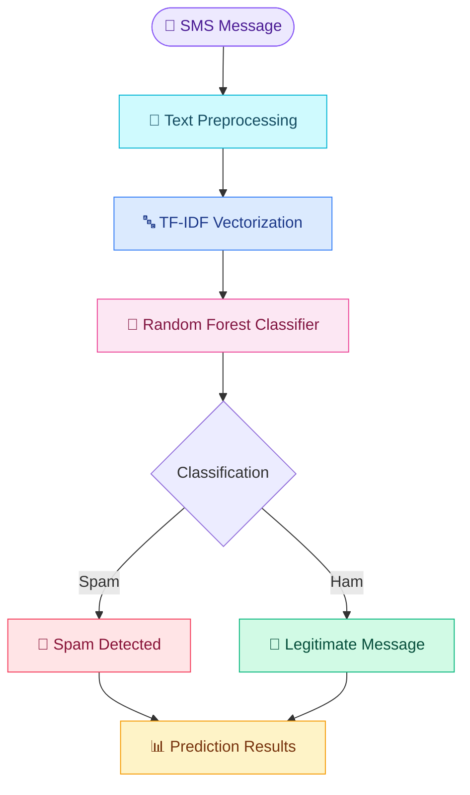
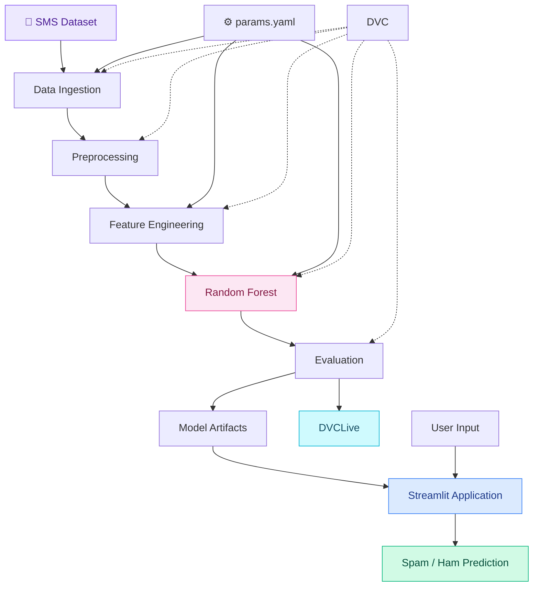

 <div align="center">


<br/>


<br/><br/>


<br/><br/>

<a href="https://github.com/Shashikala-11/SpamShield/stargazers"></a>
<a href="https://github.com/Shashikala-11/SpamShield"></a>
<a href="https://github.com/Shashikala-11/SpamShield"></a>

<br/><br/>

**✨ Intelligent SMS Classification | NLP | Random Forest | DVC | DVCLive**

</div>

---

<div align="center">

## 💌 A Cleaner Inbox Starts Here!


<br/><br/>


<br/><br/>


<br/>


</div>

## 🌈 What is SpamShield?

**SpamShield** is a Machine Learning-powered SMS Spam Detection application that classifies incoming text messages into two categories:

<table>
<tr>
<td width="50%" align="center">


### 🚨 Unwanted Messages

Identifies unwanted or spam messages using a trained classification model.

</td>
<td width="50%" align="center">


### 💚 Legitimate Messages

Recognizes genuine, non-spam messages.

</td>
</tr>
</table>

The application combines text preprocessing, TF-IDF feature extraction and Random Forest classification with an interactive Streamlit interface.

It also explores reproducible machine learning workflows using DVC and DVCLive.

---

## 🎨 Features at a Glance

<table>
<tr>
<td align="center" width="33%">


### 🧠 Smart Classification

Random Forest-based SMS classification.

</td>
<td align="center" width="33%">


### 🔤 NLP Processing

TF-IDF text feature extraction.

</td>
<td align="center" width="33%">


### ⚡ Interactive UI

Streamlit-based message analysis.

</td>
</tr>
<tr>
<td align="center">


### 📊 Model Insights

Classification and probability estimates.

</td>
<td align="center">


### 🔄 Reproducibility

DVC pipeline orchestration.

</td>
<td align="center">


### 📈 Experiment Tracking

DVCLive experiment metrics.

</td>
</tr>
</table>

---

## 🪄 How SpamShield Works

<div align="center">


</div>



### 🔬 Machine Learning Pipeline

| Stage | Description |
|:---|:---|
| 📥 Data Ingestion | Load and organize SMS dataset |
| 🧹 Preprocessing | Clean text and prepare data |
| 🔤 Feature Engineering | Convert text into TF-IDF features |
| 🌳 Model Building | Train Random Forest classifier |
| 📊 Evaluation | Evaluate classification performance |
| 📈 Tracking | Record metrics with DVCLive |

---

## 🧩 Technology Stack

<div align="center">


<br/><br/>


</div>

---

## 🏗️ Architecture



---

## 📸 See SpamShield in Action

<div align="center">


<sub>Replace this placeholder with an actual recording of your Streamlit application.</sub>

</div>

---

## ⚙️ MLOps Workflow

### 🔄 DVC Pipeline

```bash
dvc repro
```

### 📊 Experiment Tracking

```bash
dvc exp show
```

### ☁️ Remote Artifact Storage

```bash
dvc push
```

### Configuration Example

```yaml
data_ingestion:
  test_size: 0.2

feature_engineering:
  max_features: 50

model_building:
  n_estimators: 25
  random_state: 2
```

DVC manages pipeline dependencies and outputs, while DVCLive records experiment metrics and artifacts.

---

## 📁 Project Structure

```text
SpamShield/
│
├── .dvc/
├── data/
│   ├── raw/
│   ├── interim/
│   └── processed/
│
├── src/
│   ├── data-ingestion.py
│   ├── pre-processing.py
│   ├── feature-engineering.py
│   ├── model-building.py
│   └── model-evaluation.py
│
├── models/
├── reports/
├── dvclive/
├── experiments/
├── logs/
│
├── app.py
├── spam.csv
├── params.yaml
├── dvc.yaml
├── dvc.lock
└── README.md
```

---

## 🚀 Run Locally

**1. Clone**

```bash
git clone https://github.com/Shashikala-11/SpamShield.git
cd SpamShield
```

**2. Create environment**

```bash
python -m venv myenv
```

Windows:

```powershell
.\myenv\Scripts\activate
```

**3. Install dependencies**

```bash
pip install pandas numpy scikit-learn streamlit pyyaml dvc dvclive
```

**4. Reproduce pipeline**

```bash
dvc repro
```

**5. Launch application**

```bash
streamlit run app.py
```

Open `http://localhost:8501` in your browser.

---

## 🚀 Future Roadmap

- [ ] Batch SMS classification
- [ ] Model comparison and optimization
- [ ] MLflow integration
- [ ] Explainable AI
- [ ] FastAPI integration
- [ ] Docker containerization
- [ ] GitHub Actions CI/CD
- [ ] Model monitoring
- [ ] Data drift detection
- [ ] Cloud deployment

---

## 👩‍💻 Developer

<div align="center">


**Computer Engineering | Machine Learning | Data Science**

<a href="https://github.com/Shashikala-11">

</a>

<a href="https://github.com/Shashikala-11/SpamShield">

</a>

<br/><br/>


<br/><br/>


### 💜 Thanks for visiting SpamShield!

**Smarter classification. Cleaner inbox. Better ML workflows.**

⭐ Star the repository if you find it interesting!

</div>

---

<sub>Built with Python, Machine Learning, NLP and MLOps concepts. Educational project.</sub>
