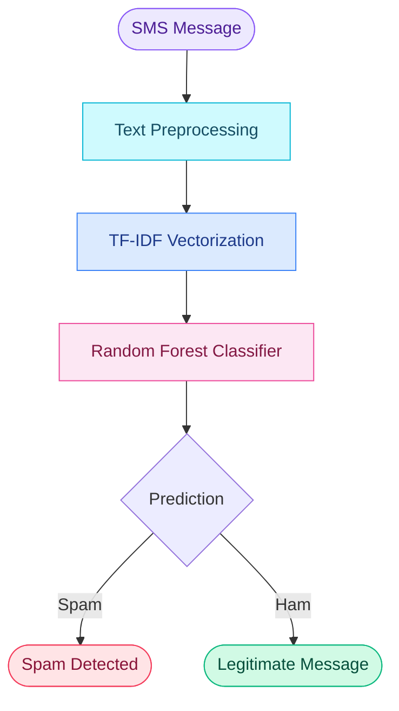
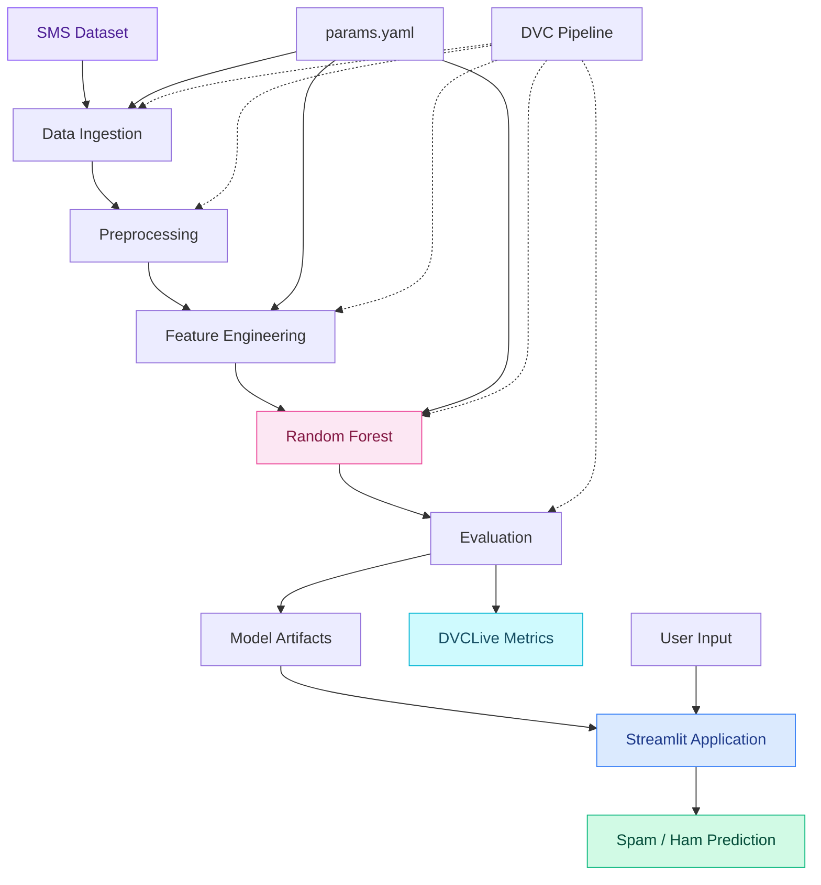

 <div align="center">


<br/>


<br/><br/>


<br/><br/>

<a href="https://github.com/Shashikala-11/SpamShield/stargazers"></a>
<a href="https://github.com/Shashikala-11/SpamShield"></a>
<a href="https://github.com/Shashikala-11/SpamShield"></a>

<br/><br/>

**Intelligent SMS Classification · NLP · Random Forest · DVC · DVCLive**

</div>

---

<div align="center">


<sub>Turning everyday text messages into meaningful predictions.</sub>

</div>

## 01 — Meet SpamShield

SpamShield is a machine learning-powered SMS classification application that identifies whether a message is **Spam** or **Ham (legitimate)**.

It brings together text preprocessing, TF-IDF feature extraction, and Random Forest classification in an interactive Streamlit application.

Alongside the prediction workflow, the project explores reproducible ML pipelines and experiment tracking using DVC and DVCLive.

<div align="center">

<table>
<tr>
<td align="center" width="50%">


### Unwanted Messages

Promotional, suspicious or unsolicited messages.

</td>
<td align="center" width="50%">


### Legitimate Messages

Genuine personal and informational messages.

</td>
</tr>
</table>

</div>

---

## 02 — The Experience

<div align="center">


<br/><br/>

<table>
<tr>
<td width="100%" align="left">

**MESSAGE INPUT**

<sub>Example message</sub>

> Congratulations! You have won a free prize. Claim your reward now!

<br/>


<sub>Illustrative classification example — not a live prediction.</sub>

</td>
</tr>
</table>

</div>

The Streamlit interface provides a simple way to submit a message and view its predicted category.

## 03 — Features

<table>
<tr>
<td width="50%" valign="top">


### Intelligent Classification

A Random Forest model classifies messages into Spam and Ham categories.

</td>
<td width="50%" valign="top">


### NLP Processing

TF-IDF transforms message text into numerical features for machine learning.

</td>
</tr>
<tr>
<td width="50%" valign="top">


### Interactive Application

A Streamlit interface for submitting messages and viewing predictions.

</td>
<td width="50%" valign="top">


### Reproducible Pipeline

DVC manages the machine learning pipeline and its dependencies.

</td>
</tr>
<tr>
<td width="50%" valign="top">


### Experiment Tracking

DVCLive records experiment metrics during model development.

</td>
<td width="50%" valign="top">


### Configurable Workflow

YAML configuration keeps selected pipeline parameters organized.

</td>
</tr>
</table>

---

## 04 — Under the Hood

<div align="center">


</div>



### Pipeline breakdown

| Phase | Operation |
|:--|:--|
| 01 · Ingestion | Load and organize the SMS dataset |
| 02 · Preparation | Clean and prepare message text |
| 03 · Feature extraction | Generate TF-IDF features |
| 04 · Training | Fit the Random Forest classifier |
| 05 · Evaluation | Evaluate classification performance |
| 06 · Application | Predict message categories |

---

## 05 — Technology Universe

<div align="center">


</div>

### 01. Core development

<div align="center">


<br/>

<sub>PYTHON &nbsp; / &nbsp; GIT &nbsp; / &nbsp; GITHUB</sub>

</div>

### 02. Data science & machine learning

<div align="center">


</div>

| Technology | Application |
|:--|:--|
| NumPy | Numerical computing |
| Pandas | Data manipulation |
| Scikit-learn | Feature extraction, model training and evaluation |
| TF-IDF | Text vectorization |
| Random Forest | Classification |

### 03. User interface

<div align="center">


<br/>


</div>

Streamlit powers the interactive message classification interface.

### 04. MLOps & experiment management

<div align="center">


</div>

These tools support pipeline reproducibility, experiment metrics and configuration management.

---

## 06 — Architecture & MLOps

The project separates model development from application-level prediction while keeping the training workflow organized.



### DVC commands

```bash
# Reproduce the pipeline
dvc repro

# Explore experiment results
dvc exp show

# Push tracked outputs to a configured remote
dvc push
```

### Configuration example

```yaml
data_ingestion:
  test_size: 0.2

feature_engineering:
  max_features: 50

model_building:
  n_estimators: 25
  random_state: 2
```

---

## 07 — Repository Structure

```text
SpamShield/
│
├── .dvc/
│
├── data/
│   ├── raw/
│   ├── interim/
│   └── processed/
│
├── src/
│   ├── data-ingestion.py
│   ├── pre-processing.py
│   ├── feature-engineering.py
│   ├── model-building.py
│   └── model-evaluation.py
│
├── models/
├── reports/
├── dvclive/
├── experiments/
├── logs/
│
├── app.py
├── spam.csv
├── params.yaml
├── dvc.yaml
├── dvc.lock
└── README.md
```

---

## 08 — Get Started

**Prerequisites:** Python 3.9+, Git and pip.

**Clone the project**

```bash
git clone https://github.com/Shashikala-11/SpamShield.git
cd SpamShield
```

**Create a virtual environment**

```bash
python -m venv myenv
```

Windows:

```powershell
.\myenv\Scripts\activate
```

**Install dependencies**

```bash
pip install pandas numpy scikit-learn streamlit pyyaml dvc dvclive
```

**Run the pipeline**

```bash
dvc repro
```

If required data or artifacts are stored in a configured DVC remote, retrieve them before running the application.

**Launch SpamShield**

```bash
streamlit run app.py
```

<div align="center">


</div>

---

## 09 — A Look Inside

<div align="center">


<sub>Application walkthrough — replace with your actual screen recording.</sub>

</div>

---

## 10 — What's Next?

| Planned enhancement | Status |
|:--|:--:|
| Batch message classification | Planned |
| Model comparison and tuning | Planned |
| Explainable AI | Planned |
| MLflow integration | Planned |
| FastAPI integration | Planned |
| Docker containerization | Planned |
| GitHub Actions CI/CD | Planned |
| Model monitoring and drift detection | Planned |
| Cloud deployment | Planned |

---

<div align="center">


**Computer Engineering | Machine Learning | Data Science**

<a href="https://github.com/Shashikala-11">

</a>

<a href="https://github.com/Shashikala-11/SpamShield">

</a>

<br/><br/>


<br/><br/>


### Thanks for visiting SpamShield!

**Smarter classification. Cleaner inbox. Better ML workflows.**

⭐ Star the repository if you find it interesting!

</div>

---

<sub>Built with Python, Machine Learning, NLP and MLOps concepts. Educational project.</sub>
